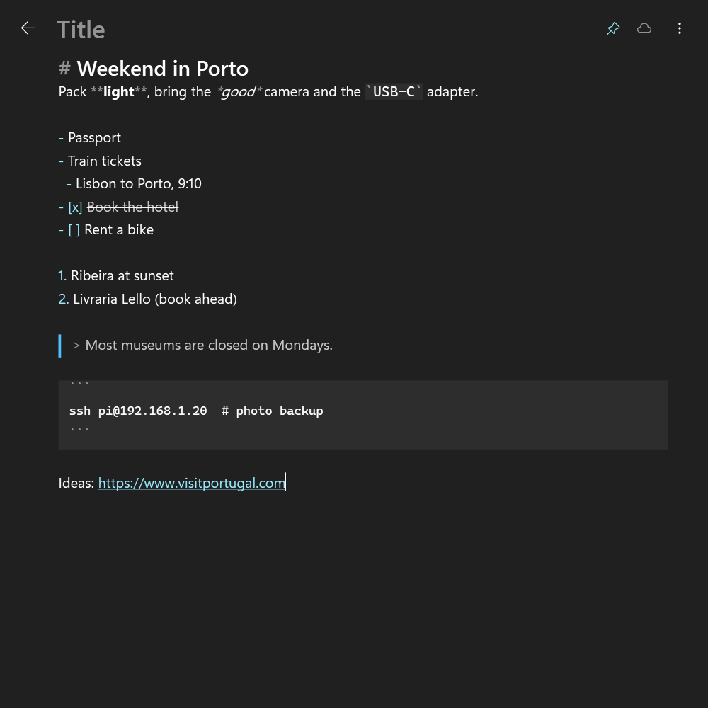
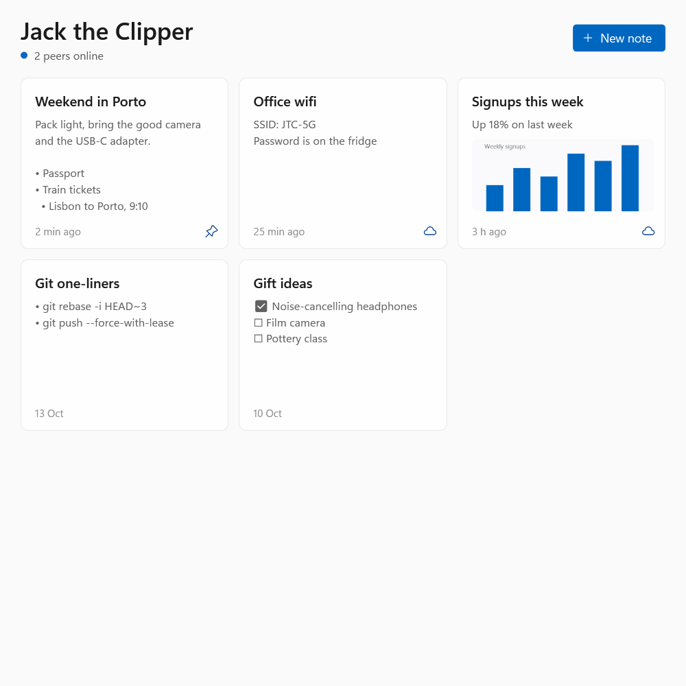

# Jack the Clipper

A floating clipboard notepad for Windows. Press a hotkey, type or paste, and it's saved. Public notes are shared
peer-to-peer with everyone running Jack the Clipper on the same network — no server, no accounts, no setup.

<p align="center">
  
  
</p>

## Features

- **Always a keystroke away.** Lives in the tray; `Ctrl+Shift+Space` shows or hides a frameless, always-on-top
  window, exactly as you left it.
- **Text and images.** Type, or paste text, screenshots and copied image files. Paste is plain text, so no stray
  formatting comes along.
- **Live Markdown.** Headings, bold, italic, strikethrough, inline code and code blocks, bullet, numbered and
  checkbox lists, quotes, dividers and links are styled as you type. Notes stay plain Markdown underneath.
- **History.** Every note saves automatically. Pinned notes stay forever and sit at the top; the rest vanish
  30 days after their last edit.
- **Public or private.** Click the cloud to share a note. Public notes sync to every copy of the app on your
  network, and notes you've received travel with you to the next network you join.
- **Copy a whole note** from the card, the `⋮` menu or a right-click.
- Light and dark mode follow Windows.

## Keyboard shortcuts

| Keys | Action |
| --- | --- |
| `Ctrl+Shift+Space` | Show or hide the window (anywhere in Windows) |
| `Ctrl+N` | New note |
| `Ctrl+Z` / `Ctrl+Y` | Undo / redo |
| `Ctrl+click` | Open a link |
| `Esc` | Hide |
| `Ctrl+W` / `Ctrl+Q` | Quit |

Right-click anywhere for the menu (Quit is always there).

## Running it

Needs Windows 10 or 11 and the [.NET 10](https://dotnet.microsoft.com/download/dotnet/10.0) SDK to build
(the Desktop Runtime is enough to run a published build).

```powershell
dotnet run                                  # run from source
dotnet publish -c Release -o publish        # then start publish\JackTheClipper.exe
```

On first launch Windows Firewall asks whether to allow network access. Allow it on **Private networks**, or other
copies of the app won't be able to find yours.

## How sharing works

- Every copy announces itself with a small UDP broadcast on port 47300 every 3 seconds.
- When another copy's notes have changed, yours fetches its public notes over TCP and merges them. The most recent
  edit of a note wins.
- Deleting a public note, or making it private, removes it from everyone else's copy too.
- Anyone on the network can read and edit public notes. There is no encryption or sign-in, so keep anything
  sensitive private, and only share on networks you trust.
- Notes from other people are treated as untrusted: their shape and size are checked, images must be real PNGs, and
  only `http`, `https` and `mailto` links can be opened.

## Where notes are kept

`%APPDATA%\JackTheClipper\notes.json`: plain JSON with each note's Markdown text and its images as base64 PNG.

## Project layout

| Path | What it is |
| --- | --- |
| `Notes.cs` | Note storage and peer-to-peer sync (no UI) |
| `Markdown.cs` | Live Markdown styling, and plain text for note cards |
| `MainWindow.xaml`, `MainWindow.xaml.cs` | The window, editor, undo, tray icon and hotkey |
| `test/` | `dotnet run --project test`: two peers syncing over the real network, plus Markdown checks |
| `icon.svg` | Source of `app.ico` |
